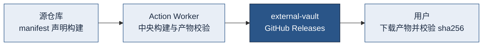

<div align="center">

# external-vault

**公开发布、可复用资产与分发元数据，不承载程序源码。**

[](https://github.com/fongap-labs/external-vault/releases) [](https://github.com/fongap-labs/external-vault/releases?q=open-code-review-v) [](https://github.com/fongap-labs/external-vault/releases?q=r-base-v) [](#许可证) [](https://github.com/fongap-labs/action-worker)

[获取产物](#获取产物) · [发布约定](#发布约定) · [治理](#治理) · [许可证](#许可证) · [安全](#安全)

</div>

> 新手请从 **这是什么** 读到 **获取产物**。维护者可直接跳到 [发布约定](#发布约定)。

## 这是什么

程序源码、测试与构建逻辑保留在各自的源仓库中。本仓库只保留公开分发元数据、可复用资料、生成型非程序资产，以及通过 GitHub Releases 发布的版本化程序产物。

## 一个例子

一个产物从源仓库到用户手中，经过的路径如下：



源仓库只声明"构建什么"，Action Worker 负责构建、校验与发布；本仓库的 Releases 是产物唯一的规范位置，Git 树中不进入任何二进制。

## 仓库内容

仓库根目录包含以下五个目录：

| 路径 | 用途 | 已分发资产示例 |
| --- | --- | --- |
| [`tools/`](tools/) | 工具索引（[`catalog.json`](tools/catalog.json)）与小型文本分发元数据 | `open-code-review`（来自 `alibaba/open-code-review` 验证镜像）、`r-base`（CRAN R 4.6.0 源码包，SHA-256 固定） |
| [`skills/`](skills/) | 可复用的分发型规范与参考资料；组织级 Agent 行为由 [Action Worker](https://github.com/fongap-labs/action-worker) 管理 | `Calendar-Heatmap.md`（日历热力图实现规范） |
| [`output/`](output/) | 报告、Feed、规则数据、简报等公开生成物 | `adfilter/`、`marketbrief/`、`pharmabrief/` |
| [`docs/`](docs/) | 仓库级工程与分发规范 | [架构](docs/ARCHITECTURE.md) · [分发治理](docs/DISTRIBUTION_GOVERNANCE.md) |
| [`.github/`](.github/) | 源仓库执行清单（manifest）与中央 CI 脚本 | — |

机器可读的完整工具目录见 [`tools/catalog.json`](tools/catalog.json)。

## 获取产物

所有版本化产物都在 [Releases](https://github.com/fongap-labs/external-vault/releases) 发布。每个 Release 附带：

- 可执行文件、安装包或压缩包；
- 与每个产物一一对应的 `.sha256` 校验文件；
- 该产物实际生效的许可证文件（如 `LICENSE.open-code-review`）。

下载后建议先校验：

```bash
sha256sum -c <产物文件名>.sha256
```

Release 说明中记录了来源证明（provenance）：源提交 SHA、中央构建的执行记录、CI Evidence 与 Main Write Guard 结论，可据此核验产物的可信来源。

## 发布约定

GitHub Releases 是版本化程序产物的规范位置（canonical location）。Release 标签按产品划分，格式如下：

```text
<release-key>-v<semver>
```

示例（均为已存在的 Release 标签）：

- `open-code-review-v1.13.0` — 同步上游 `alibaba/open-code-review` 的验证镜像（Linux amd64）
- `r-base-v4.6.0` — SHA-256 固定的 CRAN R 4.6.0 源码压缩包

程序源码、构建逻辑与二进制产物不进入 Git 树。

## 治理

仓库级规范维护在 [`docs/`](docs/) 中。跨仓库的 PR 治理、AI 评审（AI Review）、门禁（Gate）、源码策略（Source Policy）、Release 策略与组织级 Agent Skills 由 [Action Worker](https://github.com/fongap-labs/action-worker) 统一管理。本仓库的 `skills/` 目录仅包含分发资产。

文档权威顺序（自上而下，上位优先）：

```text
Action Worker shared governance
        ↓
DISTRIBUTION_GOVERNANCE
        ↓
ARCHITECTURE
        ↓
README
```

## 许可证

本仓库采用混合授权。除非另有说明，本仓库原创内容按 MIT 条款授权；第三方、衍生与生成型资产继续遵循各自上游的许可条款。

由 Action Worker 管理的跨仓库 App Release，**若源仓库 manifest 未声明其他许可证，则默认采用 `Apache-2.0`**。每个 App / Release 均可显式覆盖该默认值，实际生效的许可证随对应 Release 记录。根目录的 [LICENSE](LICENSE) 不覆盖 App Release 的许可证。

第三方归属与许可信息见 [THIRD_PARTY_NOTICES.md](THIRD_PARTY_NOTICES.md)。

## 安全

请勿在公开 Issue 中披露漏洞。使用 GitHub 私密报告：**Security → Advisories → Report a vulnerability**。详见 [SECURITY.md](SECURITY.md)。